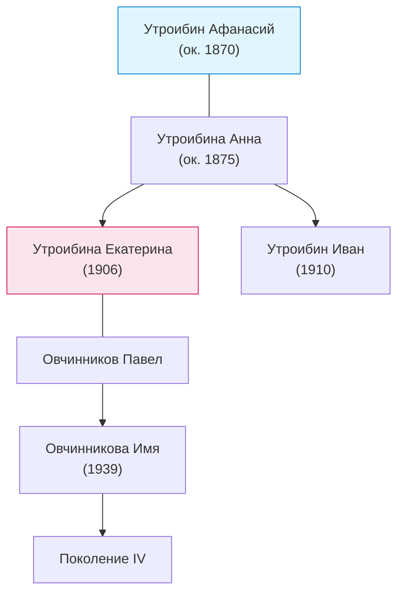

### Древо ветки (прямая мужская линия)

* **I колено (прадед):** [[Утроибин Афанасий]] (ок. 1870 — ?)
    * супруга: [[Утроибина Анна]] (ок. 1875 — ?)
    * **II колено (дети):**
        * [[Утроибина Екатерина Афанасьевна]] (1906–?) 
            * супруг: [[Овчинников Павел]]
            * **III колено (внуки):**
                * [[Овчинникова Имя Отчество]] (1939)
                    * **IV колено (правнуки):**
                        * [[Персона]]
        * [[Утроибин Иван Афанасьевич]] (1910–?)

